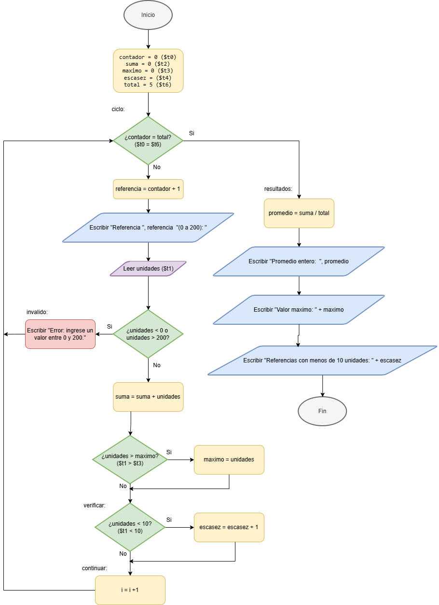
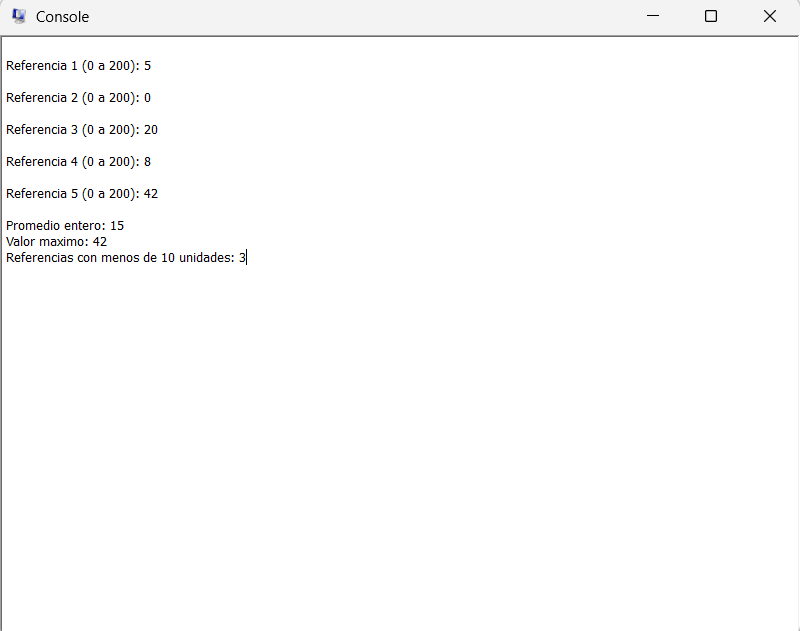
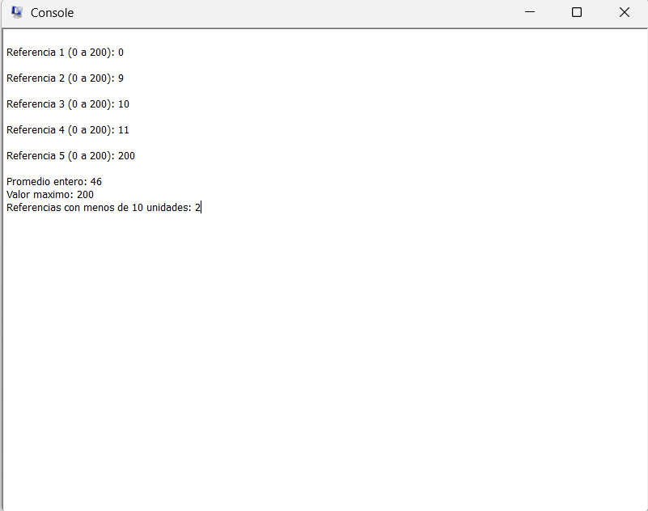
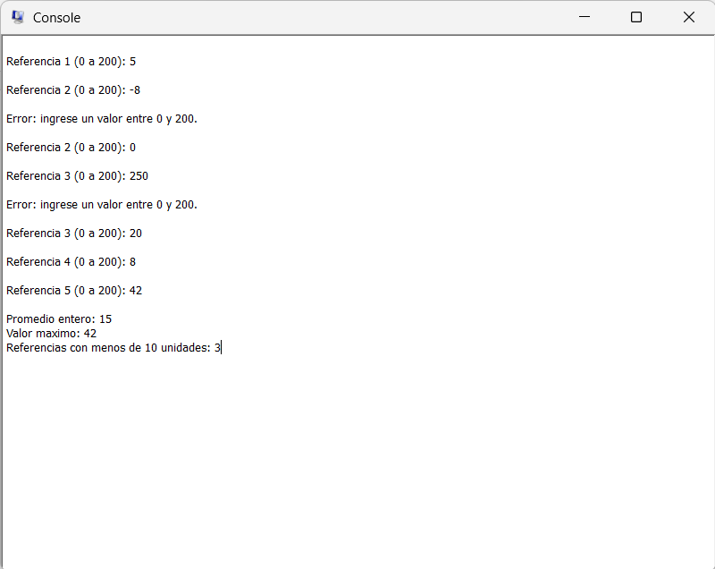

# 📦 Inventario de Repuestos | MIPS Assembly

Proyecto desarrollado en lenguaje ensamblador MIPS para la
asignatura de Infraestructura de TI de la Pontificia
Universidad Javeriana Cali.

## 📌 Descripción

El programa simula un sistema de inventario de repuestos
para un laboratorio de informática, permitiendo ingresar
las existencias de cinco referencias de artículos y
analizar su disponibilidad.

## ⚙️ Funcionalidades

- Ingreso de cinco cantidades enteras entre 0 y 200.
- Validación y rechazo de datos fuera del rango permitido.
- Cálculo del promedio entero de las existencias.
- Identificación del valor máximo.
- Conteo de referencias con menos de 10 unidades.
- Procesamiento mediante ciclos y registros.

El programa utiliza únicamente instrucciones reales del
ISA MIPS, sin emplear pseudoinstrucciones.

## 🛠️ Tecnologías utilizadas

- MIPS Assembly
- QtSpim
- PSeInt
- Git y GitHub

## 📊 Diagrama de flujo

## 🧪 Pruebas de ejecución

### Prueba 1 – Ejecución normal

Procesamiento de cinco cantidades válidas.

### Prueba 2 – Umbral de conteo

Validación de una referencia con exactamente 10 unidades,
la cual no se incluye en el conteo.

### Prueba 3 – Validación de entradas

Rechazo de valores fuera del rango sin alterar los
resultados del programa.

### Resultados obtenidos

| Prueba | Promedio | Máximo | Referencias < 10 |
|--------|----------|--------|------------------|
| Normal | 15 | 42 | 3 |
| Umbral | 46 | 200 | 2 |
| Validación | 15 | 42 | 3 |

## 🚀 Cómo ejecutar el proyecto

1. Clonar o descargar el repositorio.
2. Abrir QtSpim.
3. Cargar el archivo `Inventario_Repuestos.asm`.
4. Ejecutar el programa e ingresar las cantidades.

